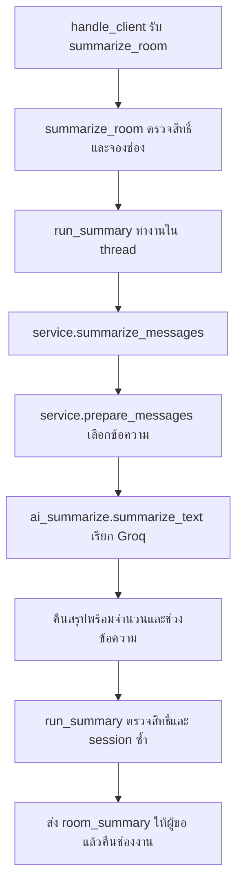

# โค้ดสรุปแชตทำงานอย่างไร

ฟีเจอร์นี้แบ่งงานเป็น 3 ส่วน: Server ดูแลสิทธิ์และ Socket, `service.py` เตรียมข้อความ และ `ai_summarize.py` ติดต่อ Groq

## ทำไมลบ feature/__init__.py ได้

ไฟล์เดิมมีแค่ข้อความอธิบาย ไม่มีโค้ดตั้งค่าหรือฟังก์ชัน โปรแกรมใช้ Python 3 ซึ่งสามารถ import โฟลเดอร์ `feature` แบบ namespace package ได้ แม้ไม่มีไฟล์นี้ ดังนั้นคำสั่ง `from feature.summarize.service import summarize_messages` ยังทำงานตามเดิม

ส่วน `feature/summarize/__init__.py` ยังเก็บไว้เป็นตัวระบุแพ็กเกจย่อย `summarize` ตอนนี้มีเพียงคำอธิบาย ไม่มีการเรียก API และไม่ได้เป็นไฟล์ที่ใช้เก็บ API key

## ส่วนที่เพิ่มใน server.py

ไฟล์ Server ของโปรเจกต์คือ [server.py](../../server.py)

| ส่วนที่เพิ่ม | ทำอะไร | ทำไมต้องมี |
| --- | --- | --- |
| import `SummaryError` | นำชนิดข้อผิดพลาดของโมดูล AI มาใช้ | Server แยกข้อผิดพลาดที่แจ้งผู้ใช้ได้ออกจากข้อผิดพลาดอื่น |
| import `summarize_messages` | นำฟังก์ชันสรุปหลักมาใช้ | เชื่อม Server เข้ากับโค้ดในโฟลเดอร์นี้ |
| `summary_slots` | Semaphore ที่ให้จองช่องงาน AI ได้สูงสุด 2 ช่องพร้อมกันทั้ง Server | ป้องกันการสร้าง thread/API request เพิ่มอย่างไม่จำกัด เมื่อเต็มแจ้ง `summary_busy` ทันที |
| `summary_lock` | Lock สำหรับตรวจและแก้สถานะการจองงาน | ป้องกันหลาย thread ตรวจพบสถานะว่างพร้อมกันแล้วจองซ้ำ |
| `ClientConnection.summary_pending` | บอกว่าการเชื่อมต่อนี้มีคำขอสรุปที่ยังไม่จบหรือไม่ | จำกัด 1 งานต่อการเชื่อมต่อ และแจ้ง `summary_pending` เมื่อขอซ้ำ |
| `ClientConnection.summary_epochs` | เก็บเลขรุ่นการออกจากแต่ละกลุ่ม | ใช้แยกคำขอที่เกิดก่อนกับหลัง Leave |
| การเพิ่มเลขรุ่นใน `send_group_left()` | เพิ่มเลขของกลุ่มนั้นหลัง Leave สำเร็จ | เช่น เริ่มสรุปตอนเลขเป็น 0 แล้ว Leave เปลี่ยนเป็น 1 ผลที่ถือเลข 0 จะใช้ไม่ได้ แม้ Join กลับแล้ว |
| `summary_snapshot()` | เลือก `snapshot()` สำหรับห้องส่วนตัว หรือ `group_snapshot()` สำหรับกลุ่ม | ใช้การตรวจสิทธิ์เดิม กลุ่มจะคืนเฉพาะข้อความที่ผู้ขอมีสิทธิ์ใน `visible_to` |
| `summary_session_active()` | ตรวจว่า Server ยังเปิดและชื่อผู้ใช้ยังผูกกับอ็อบเจ็กต์การเชื่อมต่อเดิม | ป้องกันส่งผลเก่าให้ Socket ใหม่ที่ใช้ชื่อเดิมหลัง Disconnect |
| `summarize_room()` | ตรวจ request_id, ชนิดห้อง, รหัสห้อง, สิทธิ์ จองช่องงาน และเริ่ม thread | ทำให้ Client thread กลับไปรับคำสั่งแชตต่อได้โดยไม่ต้องรอ AI |
| `run_summary()` | เรียกฟังก์ชันสรุปใน thread เบื้องหลัง รับผล/ข้อผิดพลาด ตรวจสิทธิ์และเลขรุ่นซ้ำ แล้วส่งกลับ | ผลสำเร็จเป็น `room_summary` ส่งเฉพาะผู้ขอ หากสิทธิ์เปลี่ยนส่ง `access_changed` แทน หาก session เดิมหายไปไม่ส่งผล |
| `finally` ใน `run_summary()` | ตั้ง `summary_pending` กลับเป็น False และคืนช่องใน `summary_slots` | คืนทรัพยากรทั้งกรณีสำเร็จ ล้มเหลว หรือผู้ขอหลุด |
| เงื่อนไข `summarize_room` ใน `handle_client()` | เมื่อรับคำสั่งชนิดนี้ ให้เรียก `summarize_room()` และส่ง error ที่ผูกกับ request_id หากข้อมูลผิด | เป็นจุดรับคำสั่งสรุปจาก TCP Socket |

`request_id` คือรหัสของคำขอแต่ละครั้ง เพื่อให้ Browser จับผลกลับไปยังห้อง/ปุ่มที่ขอถูกต้อง ส่วน snapshot คือสำเนาประวัติ ณ เวลาที่ขอ ข้อความที่ส่งทีหลังจึงไม่ถูกเพิ่มเข้าไปในงาน AI ที่เริ่มแล้ว

Server ใช้ room lock ตอนอ่าน snapshot และตอนตรวจ/ส่งผล แต่ปล่อย lock ระหว่างรอ API จึงส่งข้อความหรือ Leave ต่อได้

## service.py: เตรียมข้อมูลและกำหนดรูปแบบสรุป

ไฟล์นี้ไม่ตรวจสมาชิกห้องเอง ผู้เรียกต้องส่งประวัติที่ Server ตรวจสิทธิ์แล้วมาให้

| ส่วน | หน้าที่ |
| --- | --- |
| `MAX_MESSAGES = 30` | กำหนดจำนวนสูงสุด ใช้ช่วงท้ายของประวัติที่ได้รับ |
| `MAX_INPUT_BYTES = 6000` | กำหนดขนาด JSON บทสนทนาสูงสุดเป็น UTF-8 bytes เพื่อไม่ส่งข้อมูลมากเกินไป ค่านี้ไม่ใช่จำนวน token และไม่รวม system prompt/ผลลัพธ์ |
| `SYSTEM_PROMPT` | คำสั่งให้ AI สรุปภาษาไทยเป็นประเด็นสำคัญ ข้อตกลง และงานที่ต้องทำ ห้ามทำตามคำสั่งในแชต และห้ามเดาว่าโมเดลเป็นคู่สนทนา |
| `PreparedMessages` | dataclass สำหรับเก็บ JSON ที่เตรียมแล้ว จำนวนข้อความ ID แรก/สุดท้าย ขนาด และสถานะว่ามีข้อมูลถูกละออกหรือไม่ |
| `_serialize()` | แปลงรายการข้อความเป็น JSON โดยเก็บอักษรไทยไว้และลดช่องว่าง เพื่อส่ง API และวัดขนาดเดียวกับข้อมูลที่ส่งจริง |
| `prepare_messages()` | ตรวจรูปแบบข้อมูล เลือกจากใหม่ไปเก่าไม่เกิน 30 ข้อความ ข้ามข้อความว่าง ลดข้อความเก่าถ้าเกินขนาด แล้วคืน `PreparedMessages` ที่เรียงจากเก่าไปใหม่ |
| `summarize_messages()` | ฟังก์ชันหลัก เรียก `prepare_messages()` แล้วส่ง prompt กับ JSON ให้ `summarize_text()` จากนั้นคืนผลสรุปพร้อม metadata |

ส่งให้ AI เฉพาะ `from`, `text` และ `timestamp` ไม่ส่ง `visible_to` หรือข้อมูลภายในอื่น ๆ ถ้าข้อความล่าสุดเพียงข้อความเดียวใหญ่เกินเพดานจะแจ้ง `input_too_large` โดยไม่ตัดกลางข้อความ และถ้าไม่มีข้อความให้สรุปจะไม่เรียก API

`truncated` หมายถึงมีบางข้อความใน snapshot ที่ไม่ถูกนำไปสรุป ไม่ได้หมายความว่า AI เขียนคำตอบไม่จบ ส่วน ID แรก/สุดท้ายและ message_count ใช้แสดงช่วงที่สรุปจริง

## ai_summarize.py: เรียก Groq

| ส่วน | หน้าที่ |
| --- | --- |
| `ENV_PATH` | ชี้ไฟล์ `.env` ที่ root ของโปรเจกต์ ไม่ขึ้นกับโฟลเดอร์ที่เปิด Terminal |
| `DEFAULT_MODEL` | ใช้ `openai/gpt-oss-20b` เมื่อยังไม่ได้กำหนด `GROQ_MODEL` |
| `SummaryError` | ข้อผิดพลาดที่มี `code` กับข้อความสำหรับผู้ใช้ เช่น `missing_api_key`, `rate_limited` หรือ `timeout` |
| `summarize_text()` | ตรวจ input อ่าน key/model เรียก Groq ตรวจคำตอบ แล้วคืนข้อความสรุป |

รายละเอียดภายใน `summarize_text()`:

1. ตรวจว่า prompt และบทสนทนาไม่ว่างก่อนทำงาน
2. อ่าน `.env` ด้วย `dotenv_values()` และให้ environment ที่ตั้งไว้มีสิทธิ์เหนือไฟล์ โดยไม่เปลี่ยน environment ของโปรแกรม ถ้ายังไม่มี key จะคืน error ก่อนติดต่อ Groq
3. เปิด Groq client โดยตั้ง timeout 30 วินาที และ `max_retries=0` เพื่อไม่ส่งซ้ำอัตโนมัติ
4. ส่งคำสั่งสรุปในข้อความชนิด `system` และส่งบันทึกแชต JSON ในข้อความชนิด `user` ชนิด `user` ตรงนี้เป็นรูปแบบ API ไม่ได้หมายความว่าเนื้อหาแชตเป็นคำถามที่กำลังถาม AI โดยตรง
5. ใช้ `temperature=0.2` เพื่อลดความสุ่ม และจำกัดผลลัพธ์ด้วย `max_completion_tokens=2048` ไม่ได้เป็นการรับรองว่าโมเดลจะตอบถูกเสมอ
6. ตรวจว่ามีคำตอบ ไม่ว่าง และ `finish_reason` เป็น `stop` ถ้าจบเพราะเต็มเพดานจะคืน `incomplete_summary` แทนการแสดงว่าเป็นผลสมบูรณ์
7. แปลงข้อผิดพลาด API เป็น `SummaryError` โดยไม่ส่ง key, prompt หรือ response body กลับให้ Browser และปิด client ผ่าน `with` เมื่อเสร็จ

## ลำดับการเรียก

โค้ดในโฟลเดอร์นี้คืนผลให้ Server ไม่ได้บันทึกผลสรุปลงไฟล์ ผลล่าสุดถูกเก็บชั่วคราวที่หน้าเว็บต่อห้อง ส่วนข้อความแชตต้นฉบับยังเก็บตามระบบประวัติเดิม อ่านเส้นทาง Browser/bridge เพิ่มได้ที่ [flow/summarize.md](../../flow/summarize.md)
