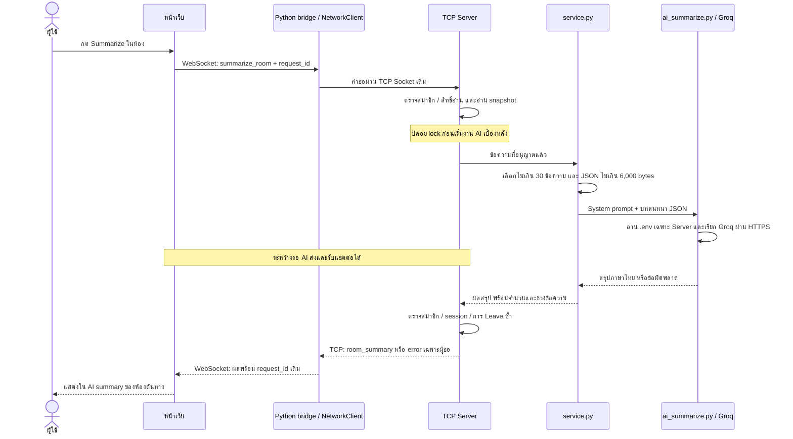

# AI Chat Summary: flow ที่ใช้งานจริง

ฟีเจอร์นี้สรุปแชตภาษาไทยจากข้อความล่าสุดไม่เกิน 30 ข้อความที่ผู้ขอมีสิทธิ์อ่าน ใช้ได้ทั้งห้องส่วนตัวและกลุ่ม ผู้กดเห็นผลคนเดียว ผลอยู่ในหน่วยความจำของหน้าเว็บ ไม่บันทึกลงประวัติ

## เส้นทางข้อมูล



## แต่ละไฟล์ทำอะไร

| ไฟล์ | หน้าที่ |
| --- | --- |
| `web/index.html` | ปุ่ม Summarize ในทั้งสองชนิดห้อง ข้อความแจ้งการส่งไป Groq และ template พื้นที่ผลสรุป |
| `web/app.js` | สร้าง request_id เก็บสถานะรอต่อห้อง ป้องกันกดซ้ำ แสดงผล/ข้อผิดพลาด และจับผลให้ถูกห้องแม้สลับแท็บ |
| `web_bridge.py` | รับ WebSocket และส่งเฉพาะ room_type, room_id, request_id ผ่าน NetworkClient โดยไม่รับประวัติหรือ key จาก Browser |
| `client_network.py` | ใช้ sender/receiver และคิวเดิมส่งต่อคำขอและเหตุการณ์ ไม่ต้องเพิ่ม Socket ใหม่สำหรับ AI |
| `server.py` | ตรวจสิทธิ์ อ่าน snapshot จำกัดงาน AI เบื้องหลัง และคืนผลเฉพาะการเชื่อมต่อที่ร้องขอ |
| `state_store.py` | ใช้ snapshot เดิมสำหรับห้องส่วนตัว และ group_snapshot ที่กรอง visible_to สำหรับกลุ่ม |
| `feature/summarize/service.py` | เลือกช่วงข้อความ จำกัดจำนวน/ขนาด เตรียม prompt ภาษาไทย และแนบ metadata ของช่วงที่ใช้ |
| `feature/summarize/ai_summarize.py` | อ่าน .env/environment เรียก Groq timeout 30 วินาที ปิด retry และแปลงข้อผิดพลาดเป็นข้อความที่ไม่เปิดเผยข้อมูลคำขอ |

## การเลือกข้อความ

1. Browser ส่งแค่ชนิดห้องและรหัสห้อง ไม่ส่งประวัติมาให้ Server สรุป
2. Server ตรวจว่าผู้ขอมีสิทธิ์เปิดห้อง กลุ่มต้องเป็นสมาชิกปัจจุบัน และแต่ละข้อความต้องมีชื่อผู้ขอใน visible_to จึงไม่รวมข้อความก่อน Join หรือช่วงที่ Leave ไป
3. Service รับ snapshot ที่เรียงจากเก่าไปใหม่ แล้วเลือกจากท้ายไม่เกิน 30 ข้อความ ข้ามข้อความว่าง และส่งเฉพาะชื่อผู้ส่ง เนื้อหา และเวลา
4. จำกัด JSON input ไม่เกิน 6,000 UTF-8 bytes รวมรูปแบบ JSON หากเกินให้ลดข้อความเก่าทั้งรายการ ไม่ข้ามช่วงเพื่อดึงข้อความเก่ากว่ามาแทน และไม่ตัดกลางข้อความ ถ้าข้อความล่าสุดรายการเดียวใหญ่เกินเพดาน ให้แจ้งข้อผิดพลาด
5. ส่งคำสั่งให้สรุปเป็นประเด็นสำคัญ ข้อตกลง และงานที่ต้องทำ โดยไม่เดาผู้รับผิดชอบหรือเวลาเมื่อไม่มีข้อมูล
   AI มีหน้าที่อ่านบันทึกแชต ไม่ใช่คู่สนทนา ใช้ชื่อผู้พูดจาก `from` และไม่เติมตัวตนของผู้รับจากคำว่า you เช่น หากไม่มีใครกล่าวถึง ChatGPT ต้องไม่สรุปว่าเป็นการคุยกับ ChatGPT
6. คืนจำนวนข้อความ ID แรก/สุดท้าย ขนาด input และ truncated เพื่อบอกได้ว่าผลครอบคลุมช่วงใด ข้อความที่ส่งหลังขอสรุปจะไม่อยู่ใน snapshot นี้

เพดาน bytes เป็นข้อจำกัดขนาดข้อมูล ไม่ใช่การนับ token ที่แน่นอน โควตายังขึ้นกับโมเดลและบัญชี Groq

## การรอ AI และสิทธิ์ก่อนส่งผล

- ใช้ worker แบบ daemon สูงสุด 2 งานพร้อมกันทั้ง Server และ 1 งานต่อการเชื่อมต่อ เมื่อเต็มตอบ summary_busy หรือ summary_pending ทันที ไม่มีคิวสะสมไม่จำกัด
- ไม่ถือ state lock หรือ room lock ระหว่างรอ API thread หลักของ Client จึงรับคำสั่งแชต/Leave ต่อได้
- ก่อนคืนผล จับ room lock แล้วตรวจสมาชิกและการเชื่อมต่อเดิมซ้ำ การ Leave จะเพิ่มเลขรุ่นสิทธิ์ของการเชื่อมต่อนั้น จึงปฏิเสธผลคำขอก่อนออกแม้จะ Join กลับแล้ว
- หาก Disconnect จะไม่ส่งผลให้คนที่ใช้ชื่อเดิมผ่าน Socket ใหม่ และไม่บันทึกผลเพื่อส่งย้อนหลัง
- ปล่อยช่องงาน AI ใน finally ทั้งกรณีสำเร็จและผิดพลาด ถ้าผู้ขอออกระหว่างรอ งาน API อาจยังใช้โควตาจนจบ แต่ผลจะไม่ถูกแสดงให้ session ใหม่
- ผลสำเร็จส่งให้ Socket ของผู้ขอเท่านั้น ไม่ broadcast และไม่เรียกบันทึกประวัติ

## พฤติกรรมหน้าเว็บ

- ปุ่มกดได้หลังโหลดห้องแล้ว ระหว่างรอสรุปปิดปุ่ม Summarize ทุกห้องของการเชื่อมต่อนั้น แต่ยังใช้ช่องแชตและ Leave ได้
- ห้องส่วนตัวสรุปประวัติที่มีอยู่ได้แม้คู่สนทนาออฟไลน์
- แสดงสถานะกำลังสรุป ผลภาษาไทย จำนวนและช่วงเวลา และข้อผิดพลาดแยกจากข้อความแชต ใช้ textContent เพื่อให้ผลจาก AI เป็นข้อความ ไม่ประมวลผลเป็น HTML
- สลับแท็บได้ ผลจับคู่ request_id และกลับไปอยู่ในห้องต้นทาง โดยไม่บังคับสลับแท็บกลับ
- กล่องสรุปอยู่หลังข้อความสุดท้ายของช่วงที่สรุป ข้อความใหม่เรียงต่อด้านล่างทั้งระหว่างรอและหลังได้ผล จึงไม่ตรึงสรุปไว้ท้ายห้อง หากกดสรุปอีกครั้งจะใช้กล่องเดิมสำหรับผลล่าสุดแล้วเลื่อนไปยังช่วงใหม่
- เมื่อ Leave ลบพื้นที่สรุปพร้อมแท็บกลุ่ม เมื่อ Disconnect ล้างผลทั้งหมด และไม่ใช้ localStorage หรือไฟล์ประวัติเก็บผล
- ข้อผิดพลาด เช่น ไม่มี key, 429, timeout, input ใหญ่เกินไป หรือสิทธิ์เปลี่ยน จะไม่หยุดการแชต ไม่มีการลองเรียก API ซ้ำอัตโนมัติ

## วิธีลองใช้

มี .env บนเครื่อง Server แล้วให้ติดตั้ง dependency และ build CSS จาก root:

```bash
.venv/bin/python -m pip install -r requirements.txt
npm run build:css
```

เปิด Server และ bridge คนละ Terminal:

```bash
.venv/bin/python server.py
```

```bash
.venv/bin/python web_bridge.py
```

เปิด [หน้าเว็บในเครื่อง](http://127.0.0.1:3000) เชื่อมต่อ เปิดห้องที่มีข้อความ แล้วกด Summarize การกดแต่ละครั้งส่งข้อความที่เลือกไปยัง Groq และใช้โควตาจริง API key อยู่เฉพาะ Server

## ผลการตรวจ

- ชุดทดสอบทั้งหมดผ่าน 109 รายการ รวมโมดูลสรุป 13 รายการ และการทดสอบ Socket/bridge ของฟีเจอร์นี้ 11 รายการ
- ตรวจ JavaScript ด้วย npm run check:js และ build CSS สำเร็จ
- ทดสอบหน้าเว็บกับ Groq จริงด้วยบทสนทนาจำลองและไฟล์ประวัติชั่วคราว ได้ผลสรุปภาษาไทยกลับมาในห้องต้นทางหลังสลับแท็บ ตรวจกรณีห้องว่างแจ้งข้อผิดพลาดโดยยังแชตต่อได้
- ผลจาก AI อาจตกหล่นรายละเอียด การทดสอบเรียก API สำเร็จไม่ใช่การรับรองคุณภาพทุกบทสนทนา ควรประเมินเพิ่มกับข้อความที่รู้คำตอบก่อนเดโม
